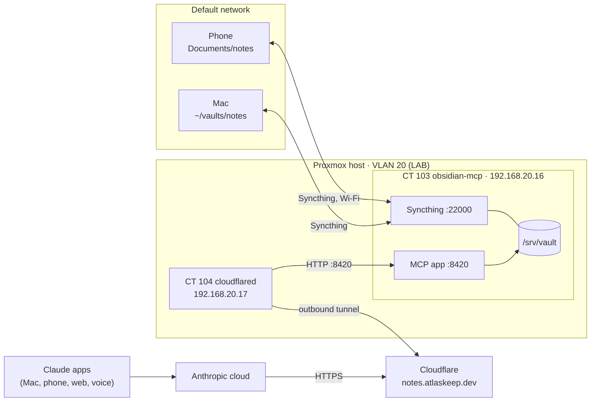

# Obsidian MCP Server

A self-hosted server that lets Claude read and write my Obsidian notes from any Claude app (Mac, phone, web and voice).

**MCP (Model Context Protocol)** is an open standard for connecting AI apps like Claude to outside tools and data. An MCP server publishes tools (for example "search notes" or "write note") that Claude can call. Here, [obsidian-web-mcp](https://github.com/jimprosser/obsidian-web-mcp) is the MCP server, and Claude connects to it as a custom connector.

**Status:** in service since 2026-11-05 (built 2026-11-02 to 2026-11-05). See [Open items](#open-items).

## How it fits together



- **Claude path:** Claude's requests come from Anthropic's cloud through a Cloudflare tunnel. Nothing at home accepts inbound connections from the internet.
- **Sync path:** Syncthing keeps the same vault on the server, the Mac and the phone. It has nothing to do with Cloudflare. Mac and phone sync directly with the server on the LAN.

| Component | Where | Address |
|---|---|---|
| MCP app + Syncthing | CT 103 `obsidian-mcp` | `192.168.20.16` (app `:8420`, Syncthing `:22000`, Syncthing UI `:8384`) |
| Tunnel connector | CT 104 `cloudflared` | `192.168.20.17` |
| Public URL | Cloudflare | `https://notes.atlaskeep.dev` |
| Vault (server) | CT 103 | `/srv/vault` |
| Vault (Mac) | Mac | `~/vaults/notes` |
| Vault (phone) | Moto G | internal storage `Documents/notes` |

## Credentials

All in two Bitwarden items:
- **Obsidian MCP:** connector sign-in (username/password), bearer token, Syncthing GUI logins (server and Mac), root passwords for CT 103 and CT 104.
- **Cloudflare (atlaskeep.dev):** Sign in with Google; tunnel token and tunnel ID.

Device IDs aren't secrets and aren't stored there.

## Containers

Both built with the [Proxmox community scripts](https://community-scripts.org) on the existing Proxmox host, choosing **Advanced**. Both are on VLAN 20 (LAB) with static IPs.

| Setting | CT 103 | CT 104 |
|---|---|---|
| Hostname | `obsidian-mcp` (`obsidian-mcp.atlas.local`) | `cloudflared` (`cloudflared.atlas.local`) |
| Script | [Debian](https://community-scripts.org/scripts/debian) | [cloudflared](https://community-scripts.org/scripts/cloudflared) |
| OS / type | Debian 13, unprivileged | Debian 13, unprivileged |
| CPU / RAM / disk | 1 core / 2 GB / 8 GB | 1 core / 512 MB / 4 GB |
| Storage | `CRUCIAL_SSD_512GB` | `CRUCIAL_SSD_512GB` |
| Network | `vmbr0`, VLAN `20`, `192.168.20.16/24` | `vmbr0`, VLAN `20`, `192.168.20.17/24` |
| Gateway / DNS | `192.168.20.1` / `192.168.0.101` (Pi-hole) | same |
| Timezone | `America/New_York` | `America/New_York` |

```bash
bash -c "$(curl -fsSL https://raw.githubusercontent.com/community-scripts/ProxmoxVE/main/ct/debian.sh)"        # CT 103
bash -c "$(curl -fsSL https://raw.githubusercontent.com/community-scripts/ProxmoxVE/main/ct/cloudflared.sh)"   # CT 104
```

Script prompts, both containers: SSH key source `found` → the Mac key and `claude-code-proxmox`; FUSE / TUN/TAP / GPU passthrough **No**; nesting **Yes** (systemd on Debian 13 needs it); mount filesystems and post-install hook empty.

- CT 103 RAM is 2 GB, not the script's 512 MB default: 1 GB ran out of memory with VS Code Remote-SSH connected.
- Containers keep their own timezone. The Proxmox host was on `America/Adak` when they were built; host and both containers were set to `America/New_York` with `timedatectl set-timezone`.

**SSH from the Mac** (`~/.ssh/config`):

```
Host obsidian-mcp
    HostName 192.168.20.16
    User root
    IdentityFile ~/.ssh/id_ed25519
    SetEnv TERM=xterm-256color

Host cloudflared
    HostName 192.168.20.17
    User root
    IdentityFile ~/.ssh/id_ed25519
    SetEnv TERM=xterm-256color
```

## App

### Repo

| | |
|---|---|
| Upstream | https://github.com/jimprosser/obsidian-web-mcp |
| Fork | https://github.com/austin2153/obsidian-web-mcp |
| Clone on the server | `/opt/obsidian-web-mcp` (owned by root; `vault` only reads and runs it) |
| Branch | `atlas` (customizations; `main` tracks upstream) |

```bash
gh repo fork jimprosser/obsidian-web-mcp --clone=false                                 # on the Mac
git clone https://github.com/austin2153/obsidian-web-mcp.git /opt/obsidian-web-mcp     # on CT 103
```

### Install

README → Prerequisites: Python 3.12+ and [uv](https://docs.astral.sh/uv/). The uv install command is from uv's docs.

```bash
curl -LsSf https://astral.sh/uv/install.sh | sh
source $HOME/.local/bin/env
cd /opt/obsidian-web-mcp
uv sync --python 3.13
```

- **Deviation from the README:** `--python 3.13` uses Debian's Python. The repo's `.python-version` asks for 3.14, which uv would otherwise download; `pyproject.toml` only needs 3.12+.
- **Deviation from the README:** the README runs `uv run vault-mcp`. We run `.venv/bin/vault-mcp` so uv doesn't switch to 3.14.
- Upstream has no `uv.lock`, so dependencies aren't pinned. Installed: uv 0.13.7 (`/root/.local/bin`), obsidian-web-mcp 0.4.0, mcp 1.30.0, pydantic 2.14.2.

### Configuration

Environment variables in `/etc/obsidian-web-mcp.env` (root, `chmod 600`). Password and token are also in Bitwarden (*Obsidian MCP*: password, and custom field *Bearer token*).

Reference: [README → Configuration](https://github.com/austin2153/obsidian-web-mcp#configuration) and [Quick Start](https://github.com/austin2153/obsidian-web-mcp#quick-start).

| Setting | Value | Source |
|---|---|---|
| `VAULT_PATH` | `/srv/vault` | README: required. Path is our choice |
| `VAULT_OAUTH_USERNAME` | `austin` | README: default `obsidian`. Ours |
| `VAULT_OAUTH_PASSWORD` | 32 letters/digits from Bitwarden | README: required, server refuses all logins without it. README generates one with `secrets.token_urlsafe(24)`; we used Bitwarden |
| `VAULT_MCP_TOKEN` | `python3 -c "import secrets; print(secrets.token_hex(32))"` | README Quick Start method (256-bit hex) |
| `VAULT_MCP_HOST` | `192.168.20.16` | README: default `127.0.0.1`, which assumes cloudflared on the same machine. Ours, because cloudflared is a separate container |
| `VAULT_MCP_PORT` | `8420` | README default |
| `VAULT_MCP_FORWARDED_ALLOW_IPS` | `192.168.20.17` | README: default `127.0.0.1`, "never set this to `*`". Ours: cloudflared's IP |
| `VAULT_MCP_PUBLIC_URL` | `https://notes.atlaskeep.dev` | README: recommended for any reverse-proxy deployment |
| `VAULT_MCP_ALLOWED_HOSTS` | `notes.atlaskeep.dev` | README: set to the tunnel hostname for any remote deployment |

### systemd service

`/etc/systemd/system/obsidian-web-mcp.service`. **Source:** the README only ships launchd templates for macOS (`scripts/launchd/`); this unit is our own, modelled on them.

```ini
[Unit]
Description=Obsidian Web MCP server
After=network-online.target
Wants=network-online.target

[Service]
User=vault
Group=vault
EnvironmentFile=/etc/obsidian-web-mcp.env
ExecStart=/opt/obsidian-web-mcp/.venv/bin/vault-mcp
Restart=on-failure
RestartSec=5

[Install]
WantedBy=multi-user.target
```

| Line | Why |
|---|---|
| `After=` / `Wants=network-online.target` | The app binds to `192.168.20.16`, so the network must be up first |
| `User=vault` / `Group=vault` | Same user as Syncthing, so both can read and write `/srv/vault` |
| `EnvironmentFile=` | systemd reads it as root before switching user, so it stays `root` / `600` and `vault` can't read it |
| `ExecStart=` | The venv's launcher, not `uv run` (see [Install](#install)) |
| `Restart=on-failure`, `RestartSec=5` | Restart after a crash; a clean `systemctl stop` stays stopped |
| `WantedBy=multi-user.target` | `enable` hooks it into normal boot |

```bash
systemd-analyze verify /etc/systemd/system/obsidian-web-mcp.service   # no output = OK
systemctl daemon-reload
systemctl enable --now obsidian-web-mcp
```

Healthy: the log shows `Starting server on 192.168.20.16:8420 with bearer auth + OAuth` and `Vault: /srv/vault`; `/health` returns `{"status":"ok",...}`; `/` without a token returns `401`.

### State directory

OAuth clients and tokens (stored as hashes) live in `~/.local/share/vault-mcp/` (README, *OAuth*), which for `vault` is `/var/lib/vault/.local/share/vault-mcp/oauth_state.sqlite3`. It's outside the vault, as the README requires. `vault`'s home is `/var/lib/vault` (system-user convention), not `/home`.

## Syncthing

[Syncthing](https://syncthing.net) is open-source, peer-to-peer file sync. Every device keeps a full local copy that works offline; there's no cloud service holding the files. Devices pair by exchanging **device IDs** (derived from each device's certificate), and all traffic is encrypted. Ports: **22000** TCP/UDP (sync), **21027** UDP (local discovery), **8384** (web UI).

| Device | Name | Device ID | Web UI |
|---|---|---|---|
| Server (CT 103) | `obsidian-mcp` | `BTAELK6-ICVBTYW-K4HSLGE-SBDZ5GQ-AOGUMQ3-V3XREMT-CLMW7Z6-WVJK2AM` | http://obsidian-mcp.atlas.local:8384 (Bitwarden: *Syncthing obsidian-mcp*) |
| Mac | `austin-mac.atlas.local` | starts `QBYJF22` | http://127.0.0.1:8384 (Bitwarden: *Syncthing Mac*) |
| Phone | `austin-motog` | starts `CQC5YQR` | in the app only |

The server is the hub: the Mac and the phone each pair with the server, not with each other, so either syncs whether or not the other is on.

### Server

From [apt.syncthing.net](https://apt.syncthing.net) (stable-v2; v2.1.7 installed), as root:

```bash
mkdir -p /etc/apt/keyrings
curl -L -o /etc/apt/keyrings/syncthing-archive-keyring.gpg https://syncthing.net/release-key.gpg
echo "deb [signed-by=/etc/apt/keyrings/syncthing-archive-keyring.gpg] https://apt.syncthing.net/ syncthing stable-v2" > /etc/apt/sources.list.d/syncthing.list

# Prefer Syncthing's packages over Debian's own (from the site's troubleshooting section)
cat > /etc/apt/preferences.d/syncthing.pref <<'PREF'
Package: *
Pin: origin apt.syncthing.net
Pin-Priority: 990
PREF

apt update && apt install -y syncthing
```

Runs as the system user `vault` (our choice; Syncthing's docs advise against root), the same user as the app:

```bash
useradd --system --create-home --home-dir /var/lib/vault --shell /usr/sbin/nologin vault
chown -R vault:vault /srv/vault
systemctl enable --now syncthing@vault
su -s /bin/sh vault -c "syncthing cli config gui raw-address set 192.168.20.16:8384"
```

- `syncthing@.service` ships with the package ([autostart on Linux](https://docs.syncthing.net/users/autostart.html#linux)); the part after `@` is the user.
- Config: `/var/lib/vault/.local/state/syncthing/config.xml`.
- The web UI listens on the IP, not the FQDN, so it doesn't depend on DNS at boot. Its password was set in the UI (**Actions → Settings → GUI**) to keep it out of shell history.

### Mac

- Vault at `~/vaults/notes`, outside OneDrive so two sync tools don't fight over the same files. Opened in Obsidian with **Open folder as vault**.
- Homebrew (v2.1.7) rather than the menu bar app (our choice); `brew services` runs it as a launchd agent at login.

```bash
brew install syncthing
brew services start syncthing
```

### Phone

Moto G stylus 5G (2024), `austin-motog.atlas.local`, `192.168.0.81` (UniFi fixed IP, Default network).

- **F-Droid:** APK from [f-droid.org](https://f-droid.org), installed after allowing *Install unknown apps* for the browser (which can be turned off again). F-Droid keeps its own apps updated.
- **[Syncthing-Fork](https://f-droid.org/packages/com.github.catfriend1.syncthingfork/)** (developer Catfriend1) from F-Droid. The official Android app was [discontinued](https://forum.syncthing.net/t/discontinuing-syncthing-android/23002); the fork's Play build lags F-Droid's. Permissions: **All files access** on, **battery optimisation** off (otherwise Android stops sync in the background), notifications on, location skipped.
- **Obsidian** from Google Play: **Open folder as vault** → `Documents/notes` (not *Create new vault* or *Sync*).
- **Runs on Wi-Fi only** (our choice, the app's run conditions left as is). Phone edits made away from home sync when it's back on Wi-Fi. **Settings → Run conditions → Run on mobile data** would sync anywhere through Syncthing's public relays (end-to-end encrypted).
- The phone's MAC `52:c2:7b:0f:90:de` is Android's private MAC, fixed per Wi-Fi network. Switching to non-persistent randomisation would break the reservation and the UniFi policy.

### Pairing

| Device | Adds | Addresses |
|---|---|---|
| Mac | `obsidian-mcp` | `tcp://192.168.20.16:22000` |
| Phone | `obsidian-mcp`, by scanning the QR from the server UI's **Actions → Show ID** | `tcp://192.168.20.16:22000, dynamic` |
| Server | `austin-mac.atlas.local` and `austin-motog`, accepted from the new-device prompt | `dynamic` |

- Local discovery is broadcast and doesn't cross VLANs, so the Mac and phone use the server's static address. `dynamic` on the phone lets it fall back to discovery and relays.
- The Mac and phone always open the connection; the firewall doesn't let the server reach them.
- When pairing a new device, scan the QR from the **server** UI (*This Device* = obsidian-mcp, ID starts `BTAELK6`), not the Mac's.

### Folder

| Setting | Server | Mac | Phone |
|---|---|---|---|
| Label / ID | `notes` / `notes` | `notes` / `notes` | `notes` / `notes` |
| Path | `/srv/vault` | `~/vaults/notes` | `Documents/notes` |
| Type | Send & Receive | Send & Receive | Send & Receive |
| Versioning | Staggered (365 days, `.stversions/`) | Staggered | None (the others keep versions) |

- Each device keeps old versions of files changed by *other* devices, so the Mac keeps what Claude edits on the server, and the server keeps what's edited on the Mac or phone.
- A new device can accept the share offer, or add the folder by hand (**Folders → +**) with Folder ID `notes`; the result is the same. The phone was added by hand because the offer didn't show.

`.stignore` doesn't sync, so each device has its own copy (phone: the folder's **Ignore Patterns**). Add it **before** the first sync:

```
// Obsidian's per-device UI state (open tabs, pane layout)
.obsidian/workspace.json
.obsidian/workspace-mobile.json

// macOS clutter
.DS_Store
```

Other `.obsidian/` settings (`app.json`, `appearance.json`, plugins) do sync, so a setting changed on one device changes on all.

## Firewall

**Source:** [Proxmox VE firewall docs](https://pve.proxmox.com/wiki/Firewall) and UniFi policies. The README doesn't cover this (its design runs everything on one Mac); the rules are our design.

Port 8420 only accepts connections from `cloudflared`, so the app is reachable only through the tunnel. The UniFi LAB zone blocks other VLANs but can't filter traffic *within* VLAN 20 (e.g. from the Talos cluster); the Proxmox firewall can, because it filters at each guest's bridge port.

### Proxmox

A guest is only filtered when **all three** are on: the datacenter switch, the guest's firewall option, and the **Firewall** flag on its network interface. Standard (iptables) firewall, not the nftables `proxmox-firewall` (a tech preview).

| Level | Setting | GUI / file |
|---|---|---|
| Datacenter | **On**; aliases defined here | Datacenter → Firewall · `/etc/pve/firewall/cluster.fw` |
| Host | **Off** by design: firewalls are per guest; UniFi limits what reaches the host | proxmox → Firewall → Options · `/etc/pve/nodes/proxmox/host.fw` |
| CT 103 | **On**, input **DROP**, output **ACCEPT**, log level `nolog` | 103 → Firewall · `/etc/pve/firewall/103.fw` |
| CT 103 `net0` | `firewall=1` | 103 → Network → net0 → Firewall ✓ |
| CT 104 | **On**, input **DROP**, output **ACCEPT**, log level `nolog` | 104 → Firewall · `/etc/pve/firewall/104.fw` |
| CT 104 `net0` | `firewall=1` | 104 → Network → net0 → Firewall ✓ |

| Alias | Address |
|---|---|
| `admin_mac` | `192.168.0.58` (Mac, DHCP reservation) |
| `cloudflared` | `192.168.20.17` (CT 104) |
| `motog` | `192.168.0.81` (phone, UniFi fixed IP) |

**CT 103 rules** (incoming; everything else is dropped):

| Proto | Port | Source | For |
|---|---|---|---|
| tcp | 8420 | `cloudflared` | MCP app, tunnel only |
| tcp | 22 | `admin_mac` | SSH / VS Code |
| tcp | 8384 | `admin_mac` | Syncthing web UI |
| tcp + udp | 22000 | `admin_mac` | Syncthing sync |
| tcp + udp | 22000 | `motog` | Syncthing sync |
| icmp | | `admin_mac` | ping |

**CT 104 rules** (incoming; everything else is dropped). cloudflared needs no inbound ports: its connections to Cloudflare and to CT 103 are outbound, and replies are allowed as established traffic. The rules protect the tunnel token on CT 104.

| Proto | Port | Source | For |
|---|---|---|---|
| tcp | 22 | `admin_mac` | SSH |
| icmp | | `admin_mac` | ping |

To debug drops, set the container's log level to `info` (→ Firewall → Options) and read `/var/log/pve-firewall.log` on the host.

### UniFi

The Mac and phone are on the Default network (Internal zone); LAB (VLAN 20) is isolated.

| Policy | Source → destination |
|---|---|
| *Allow Austin MAC to LAB* (existing) | Mac client → LAB zone, any |
| *Allow Austin Moto G to Obsidian Syncthing* | phone client `austin-motog` → `192.168.20.16` port 22000 TCP/UDP |

## Domain and tunnel

### Domain

`atlaskeep.dev`, registered 2026-11-05 with Cloudflare Registrar: 1 year, auto-renew on (renews 2027-11-05 at $12.20/yr). Cloudflare login is Sign in with Google (personal Gmail).

- A base domain for lab services (`notes.` first, others like `ha.` later). The original plan's `atlaslab.dev` was taken.
- A tunnel's public hostname must be in a domain whose DNS is on Cloudflare. Registering with Cloudflare Registrar (our choice) gives that from the start; such domains can't move to another DNS provider while registered there.
- `.dev` is on the HSTS preload list, so it only works over HTTPS; the tunnel provides that.

References: [Register a new domain](https://developers.cloudflare.com/registrar/get-started/register-domain/), [WHOIS redaction](https://developers.cloudflare.com/registrar/account-options/whois-redaction/), [Two-factor authentication](https://developers.cloudflare.com/fundamentals/user-profiles/2fa/).

### Cloudflare tunnel

`cloudflared` on CT 104 keeps an outbound connection to Cloudflare (TCP 7844). Requests to `https://notes.atlaskeep.dev` come down that connection to `http://192.168.20.16:8420`.

**Deviation from the README:** the README uses `scripts/setup-tunnel.sh` (a locally-managed tunnel and config file on the same Mac as the app). We use a **remotely-managed tunnel** from Cloudflare's docs (our choice): the tunnel and its route live in the dashboard, and CT 104 only holds a token.

| Setting | Value |
|---|---|
| Tunnel name / ID | `atlas-lab` / `3cf91843-bd25-49cb-82ba-222dfec762cb` |
| Connector | CT 104, `cloudflared` 2026.10.7 from Cloudflare's APT repo, as a systemd service |
| Token | Bitwarden: *Cloudflare (atlaskeep.dev)*, custom field *Tunnel token (atlas-lab)*. Installed with `cloudflared service install <token>`. The token is in the unit file, so `chmod 600 /etc/systemd/system/cloudflared.service` (our choice) |
| Published application | `notes.atlaskeep.dev` → `http://192.168.20.16:8420`. Cloudflare created the CNAME to `<tunnel-id>.cfargotunnel.com`. Other settings default (the Host header is passed through, which `VAULT_MCP_ALLOWED_HOSTS` checks) |

References: [Create a remotely-managed tunnel](https://developers.cloudflare.com/cloudflare-one/networks/connectors/cloudflare-tunnel/get-started/create-remote-tunnel/), [Tunnel overview](https://developers.cloudflare.com/cloudflare-one/networks/connectors/cloudflare-tunnel/), [Connectivity pre-checks](https://developers.cloudflare.com/cloudflare-one/networks/connectors/cloudflare-tunnel/troubleshoot-tunnels/connectivity-prechecks/). App README: *Remote Access with Cloudflare Tunnel*; *Cloudflare Access mode (opt-in)* for optional SSO in front (not used).

## Claude connector

Added once on claude.ai; available in every Claude app on the account. Claude connects from Anthropic's cloud (`160.79.106.x` in the app log) through the tunnel.

| Setting | Value |
|---|---|
| Connector name | `Obsidian Notes (Atlas Keep)` |
| URL | `https://notes.atlaskeep.dev` (README: MCP is served at `/`) |
| Authentication | **Sign in now** |
| OAuth client | **Register automatically**: the server supports dynamic client registration (README, *Connecting to Claude*). Not *Use Claude's published identity*, which this server doesn't support |
| Sign-in | `VAULT_OAUTH_USERNAME` / `VAULT_OAUTH_PASSWORD` (Bitwarden: *Obsidian MCP*), on the server's `/oauth/authorize` page |

**Deviation from the README:** its steps use the old **Settings → Integrations** menu. Current Claude uses **Customize → Connectors → + Add → Add custom connector**.

References: [Custom connectors using remote MCP](https://support.claude.com/en/articles/11175166-get-started-with-custom-connectors-using-remote-mcp) (help center), [Remote MCP custom connectors](https://claude.com/docs/connectors/custom/remote-mcp) (docs). App README: *OAuth* (client list and revocation).

## Operations

On CT 103:

```bash
systemctl status obsidian-web-mcp syncthing@vault
journalctl -u obsidian-web-mcp -f            # app log, including Claude's requests
journalctl -u syncthing@vault -f             # sync log
systemctl restart obsidian-web-mcp           # after editing the env file or updating the app
tail -F /srv/vault/<note>.md                 # watch a note change (-F: Syncthing replaces files)
```

Health from anywhere: `curl https://notes.atlaskeep.dev/health` → `{"status":"ok",...}`; `/` → `401`.

**Update the app:** **Sync fork** on GitHub, then `git -C /opt/obsidian-web-mcp pull`, `uv sync --python 3.13`, `systemctl restart obsidian-web-mcp`. After editing the unit file, `systemctl daemon-reload` first.

**Manual run** (troubleshooting; stop the service first). The README's Quick Start uses `export` and `uv run`; this loads the env file instead. Close the shell afterwards, since `set -a` leaves the secrets in its environment.

```bash
cd /opt/obsidian-web-mcp
set -a; . /etc/obsidian-web-mcp.env; set +a
.venv/bin/vault-mcp
```

On CT 104: `systemctl status cloudflared`; `journalctl -u cloudflared -f`. The tunnel's health also shows in the Cloudflare dashboard (Networks → Tunnels).

## Known issues

- **Don't rename by changing only capitalisation** (`20_Lab` → `20_lab`). macOS is case-insensitive and Linux isn't, so Syncthing aborts the scan with "uses different upper or lowercase characters" until it settles. Rename via a temporary name instead.
- **Conflicts:** if the same note changes on two devices before they sync (e.g. on the phone away from home, and by Claude), Syncthing keeps both as `Note.sync-conflict-<date>-….md`. Merge by hand and delete the conflict file.
- **Debian's `vi` is vim-tiny:** arrow keys in Insert mode type letters and there's no `-- INSERT --` indicator. Install `vim` for normal behaviour.

## Open items

- [ ] Make it the main vault (vault structure in progress); then point `~/.claude/CLAUDE.md` at its `_index.md`

## References

| What | Link |
|---|---|
| App (upstream / fork) | [jimprosser/obsidian-web-mcp](https://github.com/jimprosser/obsidian-web-mcp), [austin2153/obsidian-web-mcp](https://github.com/austin2153/obsidian-web-mcp) |
| MCP specification | https://modelcontextprotocol.io |
| uv | https://docs.astral.sh/uv/ |
| Syncthing | [Docs](https://docs.syncthing.net), [Firewall and ports](https://docs.syncthing.net/users/firewall.html), [Ignoring files](https://docs.syncthing.net/users/ignoring.html), [Versioning](https://docs.syncthing.net/users/versioning.html) |
| Syncthing-Fork | [F-Droid](https://f-droid.org/packages/com.github.catfriend1.syncthingfork/), [GitHub](https://github.com/Catfriend1/syncthing-android) |
| Proxmox firewall | https://pve.proxmox.com/wiki/Firewall |
| Cloudflare Tunnel / cloudflared | [Docs](https://developers.cloudflare.com/cloudflare-one/networks/connectors/cloudflare-tunnel/), [GitHub](https://github.com/cloudflare/cloudflared) |
| Claude custom connectors | [Help center](https://support.claude.com/en/articles/11175166-get-started-with-custom-connectors-using-remote-mcp), [Docs](https://claude.com/docs/connectors/custom/remote-mcp) |
