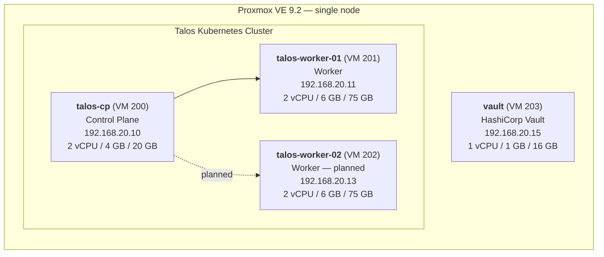

# Talos Cluster Architecture

This document describes the design decisions, infrastructure layout, and rationale behind the `atlas-talos` Terraform project.

## References

- [Talos Linux Docs](https://www.talos.dev/latest/) — official documentation
- [Talos Image Factory](https://factory.talos.dev/) — build and download Talos ISOs with extensions
- [siderolabs/talos GitHub](https://github.com/siderolabs/talos) — source and releases
- [Proxmox VE Docs](https://pve.proxmox.com/pve-docs/) — hypervisor documentation
- [bpg/proxmox Terraform provider](https://registry.terraform.io/providers/bpg/proxmox/latest/docs) — Terraform provider reference
- [siderolabs/talos Terraform provider](https://registry.terraform.io/providers/siderolabs/talos/latest/docs) — Talos provider reference
- [ArgoCD Docs](https://argo-cd.readthedocs.io/) — GitOps controller
- [MetalLB Docs](https://metallb.io/) — L2 load balancer
- [cert-manager Docs](https://cert-manager.io/docs/) — TLS certificate management

## Overview

`atlas-talos` provisions a [Talos Linux](https://www.talos.dev/) Kubernetes cluster on a self-hosted [Proxmox VE](https://www.proxmox.com/) server using Terraform. Talos is a minimal, immutable, API-driven Linux distribution built specifically for Kubernetes — there is no SSH, no package manager, and no shell. All configuration is applied via its API.

## Tech Stack

| Component | Choice | Reason |
|---|---|---|
| Hypervisor | Proxmox VE 9.2 (Debian 13 Trixie) | Existing single-node homelab server |
| OS | Talos Linux v1.12 | Immutable, Kubernetes-native, minimal attack surface |
| Terraform provider (Proxmox) | [`bpg/proxmox`](https://registry.terraform.io/providers/bpg/proxmox) | Best-maintained provider for PVE 8.x/9.x with full VM lifecycle support |
| Terraform provider (Talos) | [`siderolabs/talos`](https://registry.terraform.io/providers/siderolabs/talos) | Official provider for generating and applying Talos machine configs |
| CNI | Flannel | Simplest standard CNI; easy to migrate to Cilium later if needed |
| Terraform state backend | Terraform Cloud (local exec mode) | State versioned and locked in the cloud; plan/apply runs locally to reach Proxmox |
| GitOps | ArgoCD v3.x | Industry-standard GitOps controller; ApplicationSet for auto-discovery |
| Storage | local-path-provisioner v0.0.30 | Simple dynamic PV provisioner using node-local disk; Talos has no default StorageClass |
| Load balancer | MetalLB v0.15.3 | L2 load balancer providing external IPs for LoadBalancer services (pool: 192.168.20.50–99) |
| TLS | cert-manager v1.20.2 | Certificate management; bootstraps a self-signed CA chain for cluster-internal TLS |
| Secrets | HashiCorp Vault (Community) | Lab-wide secrets store and CA on its own Alpine VM (`vault.atlas.local`, 192.168.20.15); Raft storage; two-tier PKI (`Atlas Lab Root CA` → `Atlas Lab Intermediate CA`); External Secrets Operator bridges Vault secrets into Kubernetes |
| GitOps state sync | Flux v2.8.5 | Watches `state/` directory in this repo and applies Kratix-written manifests to the cluster |
| Platform engineering | Kratix v0.125.0 | Promise-based internal platform framework; writes workload manifests to `state/` via GitStateStore |

## Cluster Topology



Starting with 1 control plane and 1 worker. A second worker (`talos-worker-02`, VM 202, `192.168.20.13`) is planned pending the M920q hardware arriving. The Terraform is already designed to scale — adding it requires only a new IP in `worker_ips` and a Pi-hole DNS entry; `locals.tf` derives the VM ID, hostname, and MAC address automatically.

## Network Layout

| Parameter | Value |
|---|---|
| Network | Atlas Lab (VLAN 20) |
| Subnet | `192.168.20.0/24` |
| Gateway | `192.168.20.1` (Home Cloud Gateway) |
| DNS | `192.168.0.101` (atlas-pihole) |
| Proxmox bridge | `vmbr0`, VLAN tag `20` |
| Control plane | `talos-cp.atlas.local` → `192.168.20.10` |
| Worker 01 | `talos-worker-01.atlas.local` → `192.168.20.11` |
| Worker 02 *(planned)* | `talos-worker-02.atlas.local` → `192.168.20.13` |

DNS entries are managed in Pi-hole (`atlas-pihole.atlas.local`). Static IPs are configured directly in the Talos machine configs rather than via DHCP reservations.

> **Planned (with the M920q, not done yet):** a network redesign puts the whole Proxmox host on VLAN 20 untagged, so the Talos VMs drop their VLAN tag (`vlan_id` unset in Terraform), and Pi-hole moves to `192.168.20.3` (`dns_server`). VLAN 1 becomes management-only and everyday devices move to a new Home VLAN 30. Details in [lab-infrastructure.md](lab-infrastructure.md).

## VM Configuration

| Parameter | Value | Reason |
|---|---|---|
| BIOS | OVMF (UEFI) | Consistent with other VMs on this Proxmox host; Talos supports and recommends UEFI |
| EFI disk | 1M on `CRUCIAL_SSD_512GB` | Required for UEFI boot |
| Main disk | CP: 20 GB, Worker: 75 GB on `CRUCIAL_SSD_512GB` | CP needs less disk; worker stores workload data and PVs |
| Network driver | VirtIO | Best performance on Proxmox |
| ISO storage | `local` | Where ISOs are stored on this Proxmox node |
| VM disk storage | `CRUCIAL_SSD_512GB` | Primary SSD storage pool on this Proxmox node |

The Talos ISO is downloaded directly from the [Talos Image Factory](https://factory.talos.dev/) into Proxmox `local` ISO storage by Terraform using `proxmox_virtual_environment_download_file`. No manual ISO upload is required. Talos boots from the ISO, receives its machine config via the Talos API, installs itself to disk, and reboots — after which the ISO is no longer used.

## Terraform State Strategy

Terraform Cloud is used in **Local execution mode**:

- `terraform plan` and `terraform apply` run on the **local machine**, which has network access to the Proxmox server and Talos API endpoints on VLAN 20
- State is stored in and locked by **Terraform Cloud**, providing state versioning, locking (prevents concurrent runs), and a remote backup

This avoids the main limitation of fully remote execution (Terraform Cloud runners cannot reach a private homelab network) while still getting the benefits of managed state.

## Terraform File Structure

| File | Responsibility |
|---|---|
| `providers.tf` | Terraform Cloud `cloud {}` backend block + `required_providers` with version pins for `bpg/proxmox` and `siderolabs/talos` |
| `variables.tf` | Declares all input variables: Proxmox endpoint, API token, node name, cluster name, IPs, gateway, DNS, VM sizing |
| `terraform.tfvars` | Actual secret/environment-specific values — gitignored, never committed |
| `locals.tf` | Computed values derived from variables (e.g., node map, CIDR notation) |
| `proxmox-image.tf` | Downloads the Talos metal ISO into Proxmox `local` ISO storage |
| `proxmox-vms.tf` | Defines the control plane and worker VMs (UEFI, EFI disk, VLAN 20 network, disk sizing) |
| `talos.tf` | Generates Talos machine secrets, renders machine configs, applies configs to nodes, bootstraps etcd |
| `outputs.tf` | Exports `talosconfig` and `kubeconfig` from Terraform state |

## Platform Layer (GitOps)

Once the cluster is bootstrapped, a GitOps platform layer manages all cluster services declaratively.

### How It Works

1. **ArgoCD** is installed in the `argocd` namespace and connected to this repo via an SSH deploy key
2. A root **ApplicationSet** (`platform/appset.yaml`) uses a [git directory generator](https://argo-cd.readthedocs.io/en/stable/operator-manual/applicationset/Generators-Git/) to auto-discover subfolders under `platform/`
3. Each subfolder becomes an ArgoCD Application with automated sync, self-heal, and prune enabled
4. To deploy a new service: create a folder under `platform/`, add manifests, push to `main` — ArgoCD picks it up within ~3 minutes

### Platform Components

| Folder | Component | Notes |
|---|---|---|
| `local-path-provisioner/` | [Rancher local-path-provisioner](https://github.com/rancher/local-path-provisioner) v0.0.30 | Provides `local-path` default StorageClass. Two Talos-specific patches applied (see below) |
| `metallb/` | [MetalLB](https://metallb.io/) v0.15.3 | L2 mode load balancer; IP pool 192.168.20.50–99; upstream manifest + custom L2 config |
| `cert-manager/` | [cert-manager](https://cert-manager.io/) v1.20.2 | TLS management; bootstraps selfsigned → root CA → `atlas-ca` ClusterIssuer chain using ArgoCD sync waves |
| `flux/` | [Flux](https://fluxcd.io/) v2.8.5 | Source-controller watches this repo; kustomize-controller applies `state/` to cluster. Auth via `flux-system-auth` secret (SSH) |
| `kratix/` | [Kratix](https://kratix.io/) v0.125.0 | Platform engineering framework. GitStateStore writes to `state/`; Destination registers local cluster. Auth via `kratix-state-writer` secret (HTTPS PAT) |
| `vcsim/` | vmware/vcsim:latest | VMware vCenter simulator instances for testing. 2 instances: vcenter-01–02 (192.168.20.52–53) |

### MetalLB: how service IPs work

Kubernetes on bare metal has no cloud load balancer, so a `Service` of `type: LoadBalancer` stays `<pending>` forever on its own. MetalLB provides that piece.

| Part | What it does |
|---|---|
| `controller` (1 pod, `metallb-system`) | Watches `LoadBalancer` services and assigns each an address from the pool, or the one it requests |
| `speaker` (DaemonSet, 1 pod per node) | Announces assigned addresses on VLAN 20. In Layer 2 mode one speaker answers ARP for each address, so traffic for it goes to that node; if the node dies another speaker takes over in a few seconds |
| `IPAddressPool` `default-pool` | `192.168.20.50-192.168.20.99`, defined in `platform/metallb/l2-config.yaml` |
| `L2Advertisement` `default` | Tells the speakers to announce `default-pool` with ARP (Layer 2 mode) |

Traffic path: client → ARP finds the node currently announcing the address → that node → kube-proxy → the service's pods, on any node. Layer 2 mode means all traffic for one address enters through a single node at a time. That's fine at lab scale; BGP mode (which spreads load) would need a BGP-capable router.

**Giving a service an address.** Pin every address so the address plan in [index.html](index.html) stays true. Use the annotation for new services:

```yaml
metadata:
  annotations:
    metallb.io/loadBalancerIPs: 192.168.20.56
spec:
  type: LoadBalancer
```

ArgoCD (`.50`) and vcsim (`.52-.53`) use the older `spec.loadBalancerIP` field, which Kubernetes has deprecated but MetalLB still honours. Never give a VM or LXC a static address inside `.50-.99`: MetalLB assumes it owns the whole pool.

**Checking it.**

```bash
kubectl get svc -A | grep LoadBalancer                 # addresses in use
kubectl -n metallb-system get ipaddresspool,l2advertisement
kubectl -n metallb-system get pods                     # 1 controller + 1 speaker per node
kubectl -n metallb-system logs -l component=speaker    # who is announcing what
```

A service stuck at `<pending>` usually means its requested address is outside the pool or already taken.

### Talos-Specific Gotchas

| Issue | Cause | Fix |
|---|---|---|
| PVs fail to provision — path not writable | Talos `/opt` is read-only (immutable OS) | Changed ConfigMap path from `/opt/local-path-provisioner` to `/var/local-path-provisioner` |
| Helper pods blocked by PodSecurity | Talos enforces `baseline` PodSecurity by default; helper pods use `hostPath` volumes | Added `pod-security.kubernetes.io/enforce: privileged` label to `local-path-storage` namespace |
| ArgoCD syncs stale revision | ArgoCD revision cache doesn't pick up new commits immediately | Use hard refresh annotation: `argocd.argoproj.io/refresh: hard` |

### ApplicationSet Design

The root ApplicationSet uses Go templates (`goTemplate: true`). Key detail: the git directory generator provides `.path` as a **structured object**, not a string.

| Template Variable | Value |
|---|---|
| `{{ .path.path }}` | Full path (e.g., `platform/local-path-provisioner`) |
| `{{ .path.basename }}` | Folder name only (e.g., `local-path-provisioner`) |
| `{{ .path.segments }}` | Path segments as a list |

## Deployment Flow

```
terraform apply
     │
     ├── 1. Download Talos ISO → Proxmox local storage
     │
     ├── 2. Create VMs (talos-cp, talos-worker-01)
     │        Boot from ISO, waiting for Talos API
     │
     ├── 3. Generate Talos machine secrets (PKI, cluster ID, etc.)
     │
     ├── 4. Render + apply machine configs to each node
     │        Talos installs to disk → reboots → runs from disk
     │
     ├── 5. Bootstrap etcd on control plane
     │
     └── 6. Retrieve kubeconfig
              │
              └── kubectl apply flannel CNI
                       │
                       └── Nodes transition to Ready
```

## Future Considerations

- **Kratix Promises**: First promise (`proxmox-vm`) is installed and operational — provisions Proxmox VMs on demand via a Python-based workflow. Next step is expanding the promise catalog and exercising the full loop (ResourceRequest → state/ → Flux → cluster)
- **Stateful workload resilience**: don't put databases on in-cluster `local-path` PVs. AWX's in-cluster Postgres (since removed) lost its data twice after unclean Proxmox shutdowns, which is why stateful services such as AAP run as VMs or LXCs on ZFS instead
- **Additional workers**: Add IPs to `worker_ips` variable and add Pi-hole DNS entries
- **CNI migration**: Flannel can be replaced with Cilium for eBPF-based networking and network policy support
- **Talos Image Factory extensions**: Consider adding the QEMU guest agent extension for better Proxmox integration
- **High availability**: Scaling to 3 control planes would require an external load balancer or virtual IP (e.g., kube-vip) in front of the API server
- **Monitoring**: Prometheus + Grafana stack for cluster and workload observability
- **Shared storage**: Ceph/Rook for distributed storage across multiple nodes (requires additional disks or nodes)
